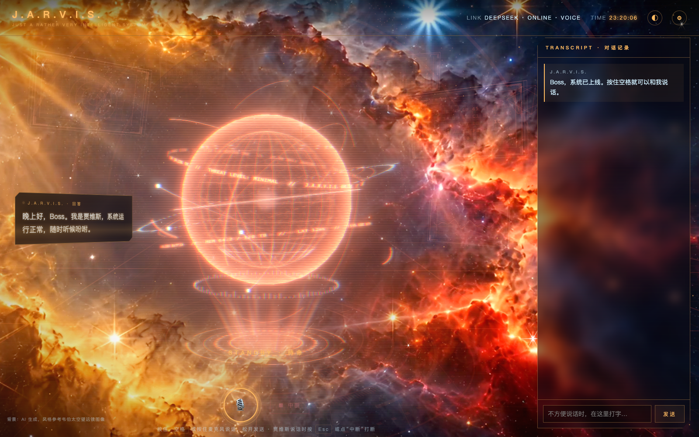

# J.A.R.V.I.S. · 我的贾维斯

一个在自己电脑上运行的中文 AI 语音助手。打开浏览器，按住空格说话，看着全息球随聆听、思考和回答改变状态，让日常聊天多一点科幻电影里的仪式感。

[](LICENSE)


## 界面预览



*当前 v1.9.2 本地运行截图，展示金色星云主题、3D 全息球和空间背景。*

<details>
<summary>查看经典网格与宇宙悬崖主题</summary>


</details>

## 它能做什么

- **和你说话** · 支持按住空格或麦克风按钮录音，也可以直接打字，回答会流式显示并朗读。
- **切换大模型** · 支持 DeepSeek 和豆包，通过配置文件填入自己的 API Key，在设置里切换服务。
- **全息视觉反馈** · Three.js 绘制全息球与空间背景，动画跟随对话状态和音量变化，并带有鼠标视差。
- **三套背景主题** · 经典网格、金色星云、宇宙悬崖，可使用仓库附带的视频背景。
- **可选的火山引擎语音** · 接入语音合成与极速语音识别，也支持浏览器自带的语音能力。
- **保留对话和偏好** · 对话记录、主题和设置保存在当前浏览器中。“关于 Boss”的备忘会随对话提供给模型。

当前功能以聊天、语音和视觉交互为主，尚不支持操作电脑、控制设备或自动执行任务。

## 快速开始

准备好 Python 3、Chrome 浏览器，以及 DeepSeek 或豆包的 API Key。聊天和云端语音需要联网，服务费用由对应平台按你的用量收取。Python 服务只使用标准库，无需安装后端依赖；Three.js 已随项目放在本地。

### 1. 下载项目

```bash
git clone https://github.com/barbaradecartes556-spec/jarvis.git
cd jarvis
```

也可以在 GitHub 点击 **Code → Download ZIP**，解压后进入项目文件夹。

### 2. 填写本地配置

**macOS** 可直接双击 `启动贾维斯.command`。首次运行会创建并打开 `~/Jarvis/config.json`，填写自己的 Key 后保存，再刷新页面。系统拦截脚本时，可在文件上右键选择“打开”，或在系统设置中允许运行。

**Windows 或手动启动** 时，把 `config.example.json` 复制到项目目录，改名为 `config.json`，再填写对应字段。文件已加入 `.gitignore`。

| 字段 | 用途 |
| --- | --- |
| `provider` | 默认服务，填 `deepseek` 或 `doubao` |
| `deepseek_api_key` | DeepSeek API Key |
| `deepseek_model` | DeepSeek 模型名，默认 `deepseek-chat` |
| `doubao_api_key` | 火山方舟 API Key |
| `doubao_model` | 已开通的豆包模型名或接入点 ID |
| `volc_api_key` | 可选，火山引擎语音 API Key |
| `volc_app_id` / `volc_access_token` | 可选，旧版语音鉴权方式 |
| `volc_voice_type` | 语音音色 ID，需要在平台开通对应音色 |
| `volc_speed` | 云端朗读语速，`1.0` 为正常速度 |

只需配置一个聊天服务就可以开始。未使用服务的密钥字段可留空；没有配置火山引擎语音时，使用浏览器语音能力。

配置文件的读取顺序为 `JARVIS_CONFIG` 环境变量指定的路径、已存在的 `~/Jarvis/config.json`、项目目录下的 `config.json`。

### 3. 启动服务

- **macOS** · 双击 `启动贾维斯.command`。
- **Windows** · 双击 `启动贾维斯.bat`，确保 `python` 命令可用。
- **手动运行** · 在项目目录执行以下命令。

```bash
python3 server.py
```

Windows 也可以执行 `python server.py`。随后用 Chrome 打开 [http://localhost:8765](http://localhost:8765)，允许麦克风权限。

页面需要通过本地服务访问，请按上述方式启动后再打开。

## 和贾维斯交谈

| 操作 | 效果 |
| --- | --- |
| 按住空格或麦克风按钮 | 开始录音，松开发送 |
| 输入文字后按 Enter | 发送文字消息 |
| 按 Esc 或点击“中断” | 打断当前回答 |
| 点击右上角 ◐ | 切换背景主题 |
| 点击右上角 ⚙ | 切换模型、调整语音、编辑备忘 |

浏览器语音识别受浏览器和网络环境影响。无法使用时，可以打字，或配置火山引擎语音。更详细的设置见 [使用说明](使用说明.md)。

## 数据与密钥

服务监听本机的 `127.0.0.1`。API Key 由 Python 服务读取，聊天请求通过它转发给所选模型服务。对话内容及“关于 Boss”的备忘会发送给模型；启用云端语音时，录音或朗读文本会发送给对应语音服务。

对话记录和设置保存在浏览器的 `localStorage` 中，清除浏览器站点数据会丢失这些记录。设置面板里的“清空对话记录”会保留“关于 Boss”的备忘。

真实的 `config.json`、配置备份、`.env` 和常见密钥文件已被忽略。请只编辑自己的本地配置，保持 `config.example.json` 为不含密钥的示例。

## 项目结构

```text
jarvis/
├── index.html              # 页面、聊天与语音交互
├── server.py               # 本地服务与模型、语音接口转发
├── holo3d.js               # 3D 全息球
├── bg3d.js                 # 3D 空间背景
├── themes/                 # 主题图片与视频
├── vendor/three/           # 本地 Three.js 及其许可证
├── config.example.json     # 不含真实密钥的配置示例
├── preview.png             # 界面预览
├── 使用说明.md
├── 启动贾维斯.command
├── 启动贾维斯.bat
└── LICENSE
```

欢迎通过 Issues 反馈问题，或提交 Pull Request 改进界面、语音体验和模型接入。

## 开源许可与致谢

项目原创代码采用 [MIT License](LICENSE)。使用、修改和分发时，请保留许可证中的版权及许可声明。

[Three.js](https://threejs.org/) 的版权和 MIT 许可证保留在 [vendor/three/LICENSE](vendor/three/LICENSE) 中。

当前页面将主题背景标注为 AI 生成、风格参考韦伯太空望远镜图像。仓库中的旧版使用说明另有 NASA、ESA、CSA、STScI 及 CC BY 4.0 的来源标注；背景素材的来源与授权说明仍需进一步统一。MIT 许可不替代第三方素材自身的授权。
